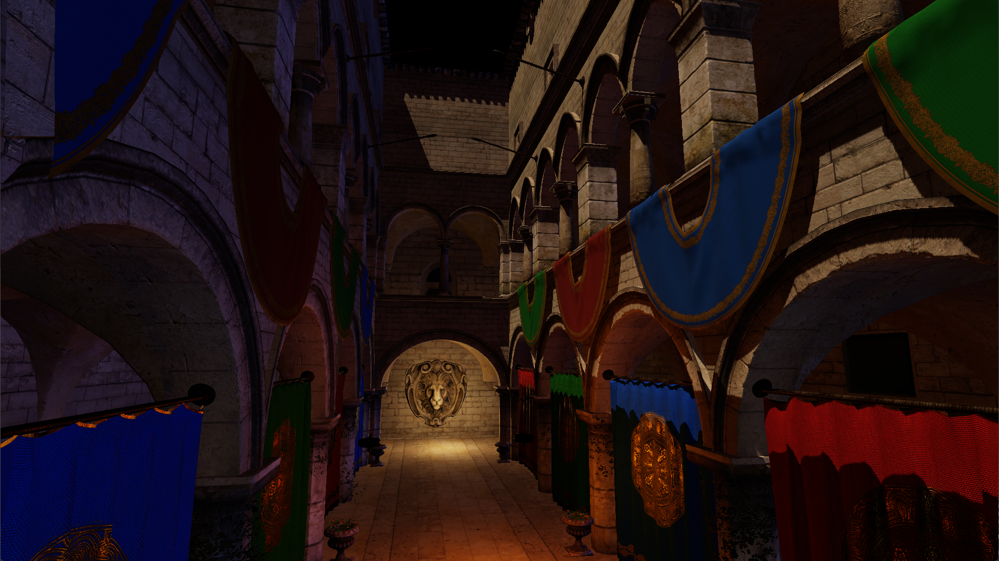
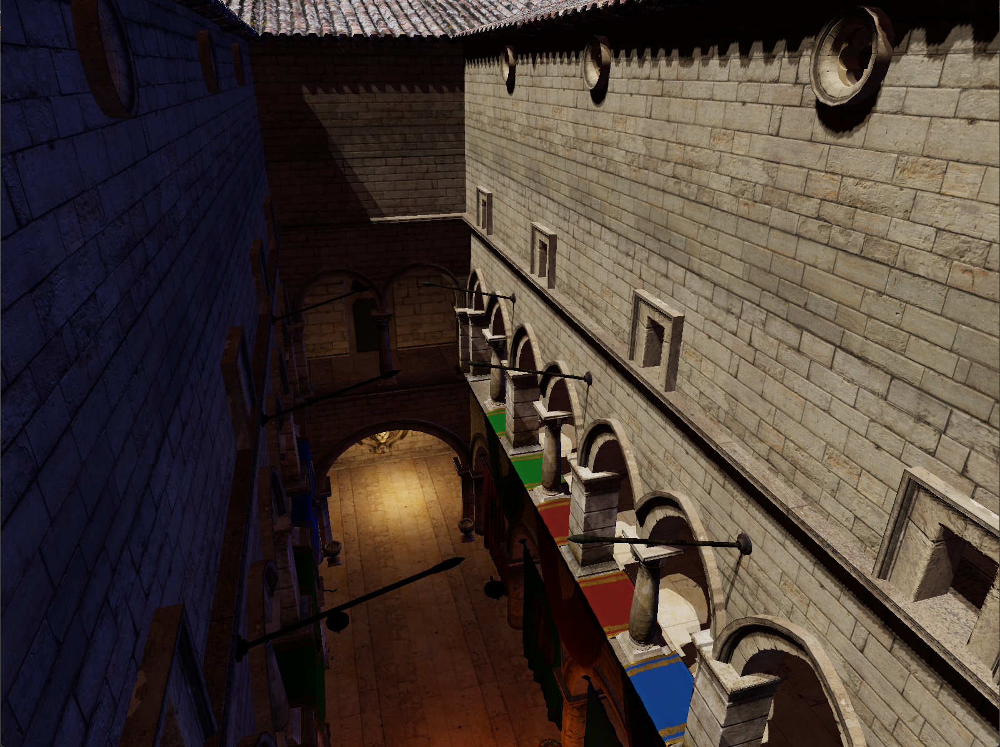
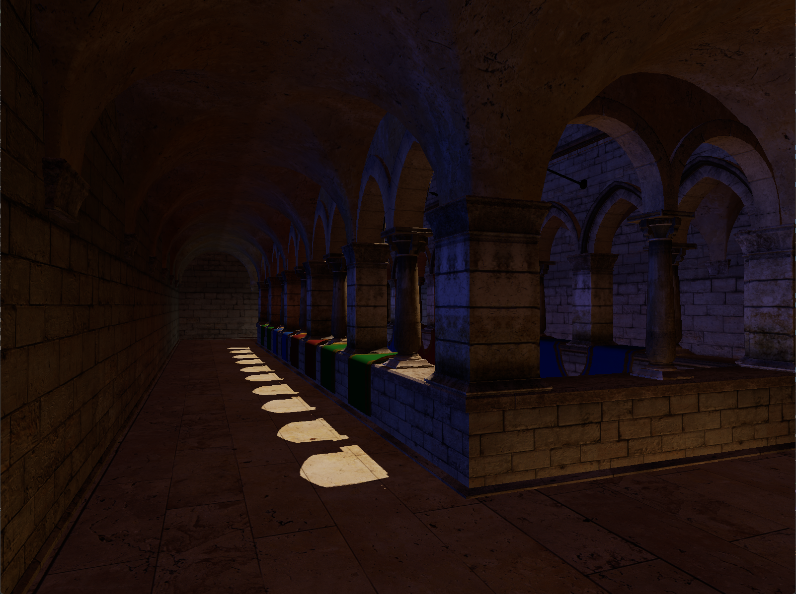

# Vulkan Renderer

A vulkan based renderer using the following pipeline:  
1. Depth-Only pass
2. GBuffer generation pass
3. Lighting pass
4. Tonemapper blit pass

Other features:  
- PBR lighting
- Directional light shadow maps
- Image Based Lighting (diffuse only)
- Physical camera and lights

## Usage
Extract the zip and run `Renderer.exe`  

### Controls

WASD: First person move. (shift increased move speed)  
Hold left mouse: Move front/back, rotate left/right  
Hold right mouse: Rotate camera  
Hold left and right mouse: move up/down

## Examples

  
  
